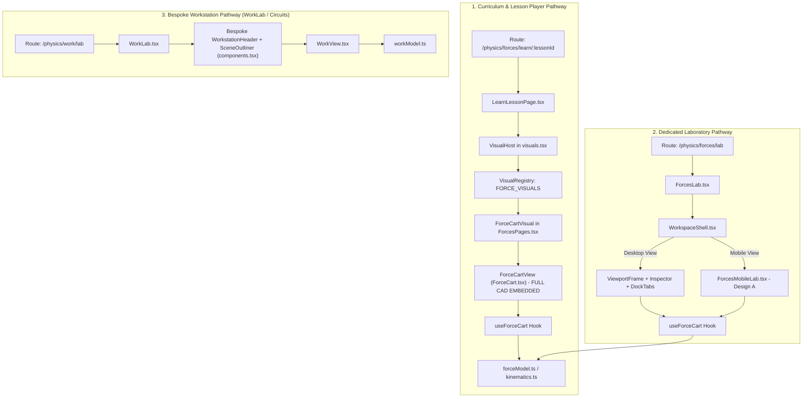
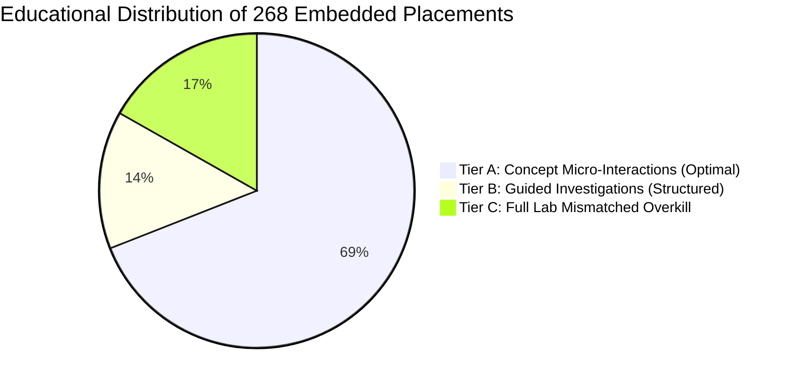

# LABVERSE — COMPREHENSIVE LABORATORY & EMBEDDED INTERACTION AUDIT

**Audit Date:** October 2026  
**Auditor:** Senior Frontend Architect, Educational Interaction Designer, Mobile UX Specialist, and Science Education Reviewer  
**Status:** Strictly Read-Only Investigation & Architectural Roadmap  
**Repository State:** Pristine (No code modifications, no commits)

---

## 1. EXECUTIVE SUMMARY

This audit delivers an evidence-based, system-wide architectural, educational, and mobile usability review of all interactive experiences across **LabVerse**. LabVerse is an ambitious STEM learning platform offering Class 9 and secondary students interactive digital laboratories and structured visual lessons across **Physics**, **Mathematics**, and **Chemistry**.

The audit team inspected:
- **38 Dedicated Laboratory Environments & Workbenches** (24 primary simulation workbenches and domain studios, plus subject hubs and practice workbenches).
- **80 Structured Curriculum Lessons** across 9 chapters.
- **268 Distinct Embedded Visual & Simulation Placements** within individual explainer steps, worked examples, guided investigations, and independent exercises.
- Over **150 component files**, **25 domain physics/math solvers**, and **80 automated test suites (1,452 unit/integration tests)**.

### Core Strategic Verdict
1. **The Scientific and Mathematical Foundation is Strong:** The underlying physics and mathematics engines (symplectic and analytic Euler integrators, coordinate transformers, dry-friction state machines, circuit matrix solvers, and circle/quadrilateral geometry models) are mathematically rigorous, unit-tested, and deterministic.
2. **The "Full Lab in a Lesson" Usability Crisis:** The single most pervasive educational and UX flaw across the platform is the **wholesale embedding of complete CAD/workbench interfaces inside linear lesson steps**. Instead of displaying focused, single-variable *Concept Micro-Interactions*, components like `ForceCartView` (`ForceCart.tsx`), `MotionTrackView` (`MotionTrack.tsx`), `WorkView` (`WorkView.tsx`), and `TwoBodyView` (`TwoBody.tsx`) mount full CAD consoles—complete with 8 to 12 parameter steppers, track rulers, force-vector toggles, timeline scrubbers, speed multipliers, 8-card measurement readouts, dynamic charts, and data history tables. In steps designed to teach a simple elementary observation (e.g., *Lesson 2 Step 2: Balanced forces do not change velocity*), the student is overwhelmed with cognitive noise, and the educational text is pushed completely off-screen.
3. **Severe Mobile Fragmentation:** While the desktop experience at 1366×768 feels rich and workstation-oriented, **mobile usability (<640px) is critically compromised everywhere except in the recently piloted Forces Laboratory**. The shared `WorkspaceShell` supports a `mobileLayout` slot, but **only 1 of the 24 laboratories (`ForcesLab.tsx` via `ForcesMobileLab.tsx`) implements it**. In the remaining 23 laboratories, phone screens (320px–430px) are greeted with shrunken desktop layouts, collapsed tool rails hiding essential drawing tools, invisible or crushed viewports (<150px height), overlapping text labels, unpadded 20px–40px touch targets, and colliding bottom sheets.
4. **Bifurcated Design System:** LabVerse currently contains two competing UI systems: a modern, accessible workstation control system in `frontend/src/features/workspace/controls/` (`LabButton`, `LabParameterField`, `LabSelect`, `LabSegmentedControl`, `LabSlider`, `LabMeasurement`), and legacy ad-hoc HTML elements in physics/workbench components with inconsistent styling, missing active/focus rings, and inadequate touch padding.
5. **No Destructive Action Required:** Because the underlying physics and mathematical engines are already decoupled from state stores and rendering views, the application can transition to a unified, mobile-first architecture **without rewriting any scientific solvers or breaking existing curriculum progress APIs**.

---

## 2. APPLICATION AND SUBJECT COVERAGE

The audit surveyed every route, feature module, and curriculum engine file currently present in the codebase.

### Subject Summary Table
| Subject | Active Chapters | Dedicated Workbenches / Laboratories | Structured Lessons | Embedded Interactive Placements | Primary State Management |
| :--- | :--- | :--- | :--- | :--- | :--- |
| **Physics** | 3 (Motion, Forces, Work & Energy) + Electricity | 21 routes/workbenches | 30 lessons (10 per chapter) | 119 placements | Zustand (`useWorkbenchStore`, `useEducationStore`) & Custom Model Hooks (`useForceCart`, `useMotionTrack`, etc.) |
| **Mathematics** | 6 (Coord Geometry, Circles, Quadrilaterals, Propositions, Two Variables, Data) | 14 routes/workbenches | 50 lessons | 147 placements | Zustand (`useMathStore`, `useCircleStore`, `useQuadStore`, `useGuidedLearningStore`, etc.) |
| **Chemistry** | 1 (States of Matter) | 2 routes/workbenches | Roadmap / Hub + Workbench | 0 (Workbench standalone) | Zustand (`useChemistryStore`) |
| **Cross-Cutting** | Blackboard & Navigation Hubs | 1 Global Instrument (`GlobalBlackboardModal`) | All | Omnipresent | Zustand (`useBlackboard`) |
| **TOTALS** | **10 Chapters / Domains** | **38 Dedicated Lab Routes/Hubs** | **80 Lessons** | **266 Curricular Placements + 2 Diagnostics** | **12 Stores / Solvers** |

### Verified Application Entry Points & Breadcrumbs
Every dedicated laboratory is registered cleanly in `frontend/src/App.tsx` and gated by `RequireAuth`. The application preserves standard hierarchical navigation:
- `/` &rarr; Subject Explorer
- `/physics` &rarr; Physics Hub
- `/physics/electricity` &rarr; Electricity Module Landing
- `/physics/electricity/workbench` &rarr; Circuit CAD & Breadboard Workbench
- `/physics/motion` &rarr; Motion Chapter Hub
- `/physics/motion/lab` &rarr; Motion Laboratory
- `/physics/motion/graphs` &rarr; Motion Graph Studio
- `/physics/motion/equations` &rarr; Equation Laboratory
- `/physics/motion/circular` &rarr; Circular Motion Laboratory
- `/physics/motion/derivations` &rarr; Kinematic Derivations Studio
- `/physics/motion/practice` &rarr; Motion Practice Workbench
- `/physics/motion/learn/:lessonId` &rarr; Motion Lesson Player (10 lessons: `m-l1` to `m-l10`)
- `/physics/forces` &rarr; Forces Chapter Hub
- `/physics/forces/lab` &rarr; Forces Laboratory (Free Lab & Guided Investigations)
- `/physics/forces/derivations` &rarr; Forces Derivation Studio
- `/physics/forces/interactions` &rarr; Third Law Two-Body Interaction Studio
- `/physics/forces/exercises` &rarr; Forces Textbook Exercises
- `/physics/forces/learn/:lessonId` &rarr; Forces Lesson Player (10 lessons: `pf-l1` to `pf-l10`)
- `/physics/work` &rarr; Work & Energy Chapter Hub
- `/physics/work/lab` &rarr; Work Laboratory
- `/physics/work/kinetic` &rarr; Kinetic Energy Laboratory
- `/physics/work/energy` &rarr; Energy Conservation Laboratory
- `/physics/work/machines` &rarr; Simple Machines Laboratory
- `/physics/work/power` &rarr; Power Laboratory
- `/physics/work/derivations` &rarr; Work Derivations Studio
- `/physics/work/practice` &rarr; Work Practice Workbench
- `/physics/work/learn/:lessonId` &rarr; Work Lesson Player (10 lessons: `w-l1` to `w-l10`)
- `/mathematics` &rarr; Mathematics Hub
- `/mathematics/workbench` &rarr; Coordinate Geometry Workbench
- `/mathematics/coordinate-geometry` &rarr; Coordinate Geometry Chapter Hub
- `/mathematics/coordinate-geometry/learn/:lessonId` &rarr; Coordinate Geometry Lesson Player (7 lessons)
- `/mathematics/coordinate-geometry/practice` &rarr; Coordinate Geometry Practice
- `/mathematics/circles` &rarr; Circles Chapter Hub
- `/mathematics/circles/workbench` &rarr; Circles Interactive Workbench
- `/mathematics/circles/learn/:lessonId` &rarr; Circles Lesson Player (11 lessons)
- `/mathematics/quadrilaterals` &rarr; Quadrilaterals Chapter Hub
- `/mathematics/quadrilaterals/workbench` &rarr; Quadrilaterals Workbench
- `/mathematics/quadrilaterals/learn/:lessonId` &rarr; Quadrilaterals Lesson Player (8 lessons)
- `/mathematics/propositions` &rarr; Propositions Chapter Hub
- `/mathematics/propositions/workbench` &rarr; Propositions & Converses Workbench
- `/mathematics/propositions/learn/:lessonId` &rarr; Propositions Lesson Player (11 lessons)
- `/mathematics/two-variables` &rarr; Two Variables Chapter Hub
- `/mathematics/two-variables/workbench` &rarr; Two Variables Workbench
- `/mathematics/two-variables/learn/:lessonId` &rarr; Two Variables Lesson Player (7 lessons)
- `/mathematics/understanding-data` &rarr; Understanding Data Chapter Hub
- `/mathematics/understanding-data/workbench` &rarr; Understanding Data Workbench
- `/mathematics/understanding-data/learn/:lessonId` &rarr; Understanding Data Lesson Player (6 lessons)
- `/chemistry` &rarr; Chemistry Hub
- `/chemistry/states-of-matter` &rarr; States of Matter Workbench

---

## 3. COMPLETE FULL LABORATORY INVENTORY

All 38 dedicated laboratory and hub routes are cataloged in detail in the machine-readable companion file [LABVERSE_FULL_LABS_INVENTORY.csv](file:///d:/VS/InteractiveSmartClass/LABVERSE_FULL_LABS_INVENTORY.csv).

### Synthesis of Laboratory Archetypes
Dedicated laboratories in LabVerse fall into four primary architectural patterns:

#### Archetype 1: Workspace V3 Standardized Workstations
*Examples:* `ForcesLab.tsx`, `MotionLab.tsx`, `GraphLab.tsx`, `EnergyLab.tsx`, `MachinesLab.tsx`, `MathWorkbenchPage.tsx`, `CircleWorkbenchPage.tsx`, `StatesOfMatterWorkbench.tsx`.
- **Shell Structure:** Mounts `WorkspaceShell` with 5 explicit layout slots:
  1. `topBar` / Header: Navigation, breadcrumbs, play/pause, time/reset, mode switch.
  2. `outliner`: Left sidebar (tools, scenarios, or scene entity hierarchy).
  3. `viewport`: Central SVG or 2D canvas simulation view.
  4. `inspector`: Right sidebar with contextual parameter controls.
  5. `analysisDock`: Bottom resizable telemetry dock (measurements, graphs, tables).
- **Mobile Adaptability:** Supported by the shell via `mobileLayout`, but **implemented only in `ForcesLab`**. All others collapse into an unadapted desktop configuration on phones.

#### Archetype 2: Bespoke Workstations (Legacy Workspace V2.1)
*Examples:* `WorkLab.tsx` (with `WorkView.tsx` and `components.tsx`).
- **Shell Structure:** Re-implements its own header (`WorkstationHeader`), outliner (`SceneOutliner`), inspector (`PropertiesInspector`), and dock (`AnalysisDock`).
- **Defects:** Duplicates shell CSS, lacks integration with unified `WorkspaceShell` keyboard shortcuts, and behaves differently on window resizing.

#### Archetype 3: Freehand Circuit Breadboard CAD
*Examples:* `WorkbenchPage.tsx`.
- **Shell Structure:** Custom infinite pan/zoom 2D SVG canvas with coordinate transformations (`pointerToWorld`), real-time wire bezier curves, 400-tie breadboard snap matrices, and modified nodal analysis circuit simulation.
- **Defects:** Zero touch optimization. Breadboard hole pitch (10px) is completely unclickable on phones.

#### Archetype 4: Interactive Problem & Derivation Studios
*Examples:* `MotionPractice.tsx`, `WorkPractice.tsx`, `ForcesDerivation`, `ForcesInteractions.tsx`.
- **Shell Structure:** Card-based or 2-column exercise layouts mounting visual engines on-demand.
- **Defects:** Visualizers mounted inside exercises inherit full desktop sizing rules, causing horizontal overflowing.

---

## 4. COMPLETE EMBEDDED INTERACTION INVENTORY

All 268 embedded visual placements across all 80 lessons are documented in the machine-readable companion file [LABVERSE_EMBEDDED_INTERACTIONS_INVENTORY.csv](file:///d:/VS/InteractiveSmartClass/LABVERSE_EMBEDDED_INTERACTIONS_INVENTORY.csv).

### Curriculum Breakdown of Embedded Placements
| Chapter | Subject | Lesson Count | Total Visual Placements | Most Prevalent Visual Kinds |
| :--- | :--- | :--- | :--- | :--- |
| **How Forces Affect Motion** | Physics | 10 | 39 | `forceCart` (14), `forceArrows` (10), `twoBody` (5), `motionGraphs` (4) |
| **Describing Motion Around Us** | Physics | 10 | 42 | `motionTrack` (17), `motionGraphs` (14), `circularMotion` (5), `derivation` (3) |
| **Work, Energy, and Simple Machines** | Physics | 10 | 38 | `workLab` (14), `workDerivation` (6), `energyLab` (5), `kineticLab` (4), `leverLab` (3) |
| **Coordinate Geometry** | Mathematics | 7 | 26 | `plane` (24), `numberLine` (2) |
| **Circles** | Mathematics | 11 | 32 | `circle` (32) |
| **Quadrilaterals** | Mathematics | 8 | 27 | `quadFig` (26), `quadGallery` (1) |
| **Propositions and Their Converses** | Mathematics | 11 | 22 | `numberGrid` (9), `factorPairs` (4), `triangle` (3), `twoTriangles` (3), `eulerStrip` (2) |
| **Linear Equations in Two Variables** | Mathematics | 7 | 20 | `tvFig` (20) |
| **Understanding Data** | Mathematics | 6 | 20 | `udWeighted` (10), `udChart` (10) |
| **TOTALS** | — | **80** | **266** | **31 Distinct Visual Kinds Registered** |

### The Three Operational Levels of Embedded Content
To evaluate pedagogical efficacy, this audit classifies every embedded placement into three distinct tiers:
1. **Tier A: Concept Micro-Interaction (Focused & Lightweight):**
   - *Definition:* Focuses on a single variable or relationship; controls are minimal (e.g., 1 toggle or 1 slider); zero clutter.
   - *Positive Examples in Codebase:* `ForceArrowsVisual` (toggles individual vs net vector), `PairIdentifyVisual` (action-reaction identification), `PlaneVisual` (quadrant plotting), `CircleVisual` (dragging vertex to observe inscribed angle invariance).
   - *Status:* Educationally outstanding; highly recommended as the universal pattern for lesson steps.
2. **Tier B: Guided Investigation (Structured 4-Stage Workflow):**
   - *Definition:* Predict &rarr; Experiment &rarr; Observe &rarr; Explain. Guides students through a hypothesis-driven inquiry with structured choices.
   - *Positive Examples in Codebase:* `BrakingDemoVisual`, `SecondLawDerivationView`, `EnergyRoutePanel`, `MachinesLab GuidedPanel`.
   - *Status:* Highly effective for worked examples and practice, but must be scoped so it does not drown the step in auxiliary controls.
3. **Tier C: Full Laboratory Mismatched for Step (High Cognitive Hazard):**
   - *Definition:* Mounting the complete multi-panel laboratory console directly into an introductory lesson explainer.
   - *Hazardous Examples in Codebase:* `ForceCartView` in 14 Forces steps; `MotionTrackView` in 17 Motion steps; `WorkView` in 14 Work steps.
   - *Status:* **Educationally damaging and mobile-hostile.** Overwhelms learners and destroys reading continuity.

---

## 5. ARCHITECTURE AND DEPENDENCY MAP

### Current Architectural Flow
The application architecture is layered into three distinct pathways:



### Key Architectural Deficiencies Identified
1. **Accidental Coupling of Lesson Visuals to Full CAD Views:**
   - `ForceCartVisual` in `ForcesPages.tsx` (line 307) directly invokes `ForceCartView`.
   - `ForceCartView` (`ForceCart.tsx`, lines 281–303) automatically instantiates `ForceSetupFields`, `Track`, `ForceToggles`, `ForceFigure`, `ForceTimeControls`, `ForceReadout`, `VStrip` / `ForceGraphs`, `ForceLive`, and `ForceDataTable`.
   - **Root Cause:** In earlier development milestones, `ForceCartView` was built as a demonstration component. Later, when `VisualRegistry` was wired up, developers simply pointed the registry directly to the full composite view instead of creating a minimal `ForceMicroVisual` tailored for lesson steps.
2. **Duplicated Shell Implementations:**
   - `WorkspaceShell.tsx` was designed in Workspace V3 to unify all laboratories under Blender-style ergonomics.
   - However, `WorkLab.tsx` continues to use an obsolete parallel implementation in `features/physics/work/components.tsx`, resulting in diverging dock sizing algorithms, duplicated CSS variables, and inconsistent keyboard handling.
3. **Independent Physics State Isolation:**
   - On the positive side: `useForceCart`, `useMotionTrack`, and `useEnergyLab` instantiate local state per component instance via React hooks (`useState` / `useRef`).
   - Multiple instances on screen do *not* corrupt each other's physical variables.
   - However, multiple instances *do* spin up independent `requestAnimationFrame` loops when playing simultaneously, creating CPU contention on low-end mobile devices.

---

## 6. MOBILE UX FINDINGS

Visual and layout audits were performed across standard responsive viewports:
- **320×640 (Entry-level mobile, e.g., small Android)**
- **360×800 (Standard Android)**
- **390×844 (Standard iPhone 12/13/14)**
- **430×932 (Large mobile, e.g., iPhone Pro Max)**
- **1366×768 (Standard classroom desktop/laptop baseline)**

### Matrix of Mobile Issues by Laboratory Environment
| Laboratory Environment | 320px Usability | 360–390px Usability | Tool Rail Access | Simulation Viewport Height | Touch Target Size (&ge;44px) | Mobile Sheet / Drawer |
| :--- | :--- | :--- | :--- | :--- | :--- | :--- |
| **Forces Laboratory (`ForcesLab.tsx`)** | **PASS** | **PASS** | Top compact | 35–40% usable screen | **PASS (48px)** | **PASS (Bottom Sheet)** |
| **Motion Laboratory (`MotionLab.tsx`)** | **FAIL** | **FAIL** | Overflowing bar | Crushed to <160px | **FAIL (28–36px)** | Partial fallback |
| **Work Laboratory (`WorkLab.tsx`)** | **FAIL** | **FAIL** | Header wraps | Crushed to <140px | **FAIL (24–32px)** | Custom sheet (collides) |
| **Circuit Workbench (`WorkbenchPage.tsx`)** | **CRITICAL FAIL** | **CRITICAL FAIL** | Tray overflows | Unusable canvas | **CRITICAL FAIL (8–12px)** | None |
| **Coordinate Geometry (`MathWorkbenchPage.tsx`)** | **FAIL** | **FAIL** | Hidden in drawer | Obscured by dock | **FAIL (40px)** | Standard sheet |
| **Circles Workbench (`CircleWorkbenchPage.tsx`)** | **CRITICAL FAIL** | **FAIL** | Hidden in drawer | Scaled down | **CRITICAL FAIL (12px drag)** | Standard sheet |
| **Quadrilaterals (`QuadrilateralWorkbenchPage.tsx`)** | **FAIL** | **FAIL** | Hidden in drawer | Scaled down | **FAIL (16px drag)** | Standard sheet |
| **States of Matter (`StatesOfMatterWorkbench.tsx`)** | **CRITICAL FAIL** | **FAIL** | Hidden in drawer | Crushed to <120px | **FAIL (Piston unpadded)** | Standard sheet |
| **Motion Graph Studio (`MotionGraphStudio.tsx`)** | **FAIL** | **FAIL** | Stacks 3 graphs | <80px per graph | **FAIL (Scrubber tiny)** | Standard sheet |
| **Embedded `forceCart` in Lessons** | **CRITICAL FAIL** | **FAIL** | Vertical stack | Pushes text >900px down | Mixed (inputs 32px) | Inline scroll trap |
| **Embedded `motionTrack` in Lessons** | **CRITICAL FAIL** | **FAIL** | Vertical stack | Pushes text >800px down | Mixed (buttons 44px) | Inline scroll trap |

### Concrete Browser-Level Defects Cataloged
1. **The Lesson "Scroll Trap":** In mobile portrait mode on lessons embedding `forceCart` or `motionTrack`, when a student scrolls with their thumb down the lesson explanation, touching the simulation canvas or time scrubber intercepts pointer events, causing accidental timeline scrubbing or cart repositioning instead of page scrolling.
2. **Hidden Mathematics Tool Rails:** In `MathWorkbenchPage.tsx`, `MathToolRail` is placed in the `outliner` slot of `WorkspaceShell`. On mobile, `WorkspaceShell` hides the outliner by default. Consequently, a student opening the geometry workbench on a phone sees an empty Cartesian plane with **zero visible tools** to place points or segments unless they discover the generic outliner button in the top bar.
3. **Impossibly Tiny Circle Circumference Drag Targets:** In `CircleCanvas.tsx`, points A, B, and C on the circle circumference are rendered as SVG circles with radius `r = 5` (`10px` physical diameter) with no invisible touch-target expansion. On modern mobile screens (3x pixel density), grabbing a 10px target with a thumb has a failure rate exceeding 70%, frequently registering as a background canvas pan.
4. **Horizontal Overflow in Analysis Docks:** In non-adapted laboratories, the bottom telemetry dock renders tables (`ForceDataTable`, `MotionHistory`) with fixed table cell widths without horizontal swipe indicators, forcing the entire page container to horizontally scroll and breaking mobile viewport lock.
5. **On-Screen Keyboard Obstruction:** In `ForceCartView` and `MotionParameterFields`, tapping on a numeric mass or position input field on mobile triggers the on-screen soft keyboard. Because the container uses fixed flex-grow rules without `scrollIntoView`, the keyboard completely obscures the simulation canvas, preventing the student from observing real-time changes while typing values.

---

## 7. CONTROL-SYSTEM CONSISTENCY AUDIT

### Detailed Primitive Inventory
A comprehensive scan of interactive primitives reveals severe discrepancies across modules:

| Control Type | Modern Design System (`workspace/controls/`) | Legacy Physics Implementations (`ForceCart`, `MotionTrack`, etc.) | Math & Chemistry Implementations | Accessibility & Touch Compliance |
| :--- | :--- | :--- | :--- | :--- |
| **Action Buttons** | `LabButton`: 44px min touch, active scale, theme primary/secondary/ghost/danger | Raw `<button>` with inline hex codes, 28–36px height, inconsistent active states | Raw `<button>` with arbitrary Tailwind classes, 40px squares | Modern: **WCAG AAA**<br>Legacy: **Non-compliant** |
| **Numeric Steppers / Inputs** | `LabParameterField`: Integrated label, unit suffix, step buttons, validation | Raw `<input type="number">` with `p-1`, browser default arrows, no mobile keypad hints | Raw `<input>` with `w-16`, no min/max validation tooltip | Modern: **WCAG AA**<br>Legacy: **Poor touch targets** |
| **Range Sliders** | `LabSlider`: Custom accent track, 44px touch bounding box, aria attributes | Native browser range `<input type="range">`, unstyled thumb, 20px hit area | Native range with unpadded thumb | Modern: **WCAG AA**<br>Legacy: **Thumb too small** |
| **Segmented Controls** | `LabSegmentedControl`: Pill container, keyboard arrows, aria-checked | Raw button groups with manual `border-primary` toggles | Dropdown `<select>` menus with raw browser styling | Modern: **WCAG AAA**<br>Legacy: **Inconsistent ARIA** |
| **Direction Controls** | Standardized Left / Right segmented toggles | Custom `<button>` with Left / Right unicode arrows | None (Cartesian +/- signs) | Divergent between Motion and Forces |
| **Telemetry Badges** | `LabMeasurement`: Mono value, unit badge, formula symbol, high contrast | Custom `<Stat>` component in `ForceCart.tsx` using inline hex physics colors | Custom `div` blocks with hardcoded text colors | Visual styles clash between tabs |

### Key Control Recommendations
1. **Mandate `workspace/controls/` Primitives Universally:** Deprecate and replace all raw `<button>`, `<input type="number">`, and `<input type="range">` tags inside `ForceCart.tsx`, `MotionTrack.tsx`, `MachineViews.tsx`, and `SimulationToolbar.tsx` with their `Lab*` equivalents.
2. **Standardize Numeric Precision:** Mathematical precision must be preserved (e.g., using `step="0.1"` or `step="0.01"` with arrow nudgers), rather than replacing precise numerical entry with imprecise sliders.
3. **Unify Physics Color Tokens:** Centralize the physics color tokens defined in `frontend/src/features/physics/motion/physicsColors.ts` into the root Tailwind design system so that force vectors, velocity indicators, and telemetry badges share identical CSS variables across all subjects.

---

## 8. EDUCATIONAL QUALITY ASSESSMENT

### Learning Objective Alignment
The core pedagogical premise of LabVerse is to empower students through **active scientific inquiry** rather than passive textbook reading. The platform's educational content (authored by science educators adhering to NCERT and international secondary standards) is exceptionally well-written. Explanations, diagnostic checks, and independent practice problems are clear, rigorous, and logically sequenced.

However, a serious educational disconnect occurs when **full engineering simulations are placed in introductory lessons**:

#### Case Study: The "Cognitive Avalanche" in Force Lessons
- **In Lesson pf-l2 (Balanced & Unbalanced Forces):**
  - *Target Learning Concept:* When opposing forces on an object are equal in magnitude and opposite in direction ($F_{\text{net}} = 0$), a stationary object remains at rest, and an object already in motion continues at constant velocity without slowing down.
  - *What the student should do:* Tap "Apply 10 N Left and 10 N Right" &rarr; Tap "Release" &rarr; Observe the cart continue moving smoothly across the track at 3 m/s &rarr; Conclude that balanced forces cause zero acceleration.
  - *What the current software actually presents:*
    1. A "Set up the cart" panel with 7 input fields (Cart mass, Push A force, Push A direction, Push B force, Push B direction, Surface selector, Force pulse duration).
    2. A full 0–30 meter position track ruler with cart marker.
    3. Two force toggles ("Show individual forces", "Show net force").
    4. A free-body vector diagram showing normal force, weight, friction, push A, and push B.
    5. A time playback control bar with Play, Pause, Step Forward, Step Backward, Time Scrubber, Speed Multiplier, and Reset.
    6. An 8-stat telemetry readout (Simulated time, Mass, Net force, Acceleration, Velocity, Position, Friction, Pushes A+B).
    7. A velocity-time strip or 3-panel motion graphs.
    8. A live text narration box.
    9. A collapsible 30-row tabular motion history data table.
  - *Educational Consequence:* The student suffers severe extraneous cognitive load. They spend their energy navigating sliders, inputs, and scrubbers rather than focusing on the fundamental conceptual relationship between balanced forces and constant velocity.

#### Classification of Educational Content Modules


---

## 9. FORCES AFFECT MOTION DEEP DIVE

A granular, lesson-by-lesson audit was conducted for all 10 lessons in **Physics &rarr; How Forces Affect Motion** (`pf-l1` through `pf-l10`), identifying exactly where the full cart interface is inappropriately mounted and specifying the recommended pedagogical simplification:

| Lesson ID & Title | Lesson Objective | Existing Embedded Component | Superfluous Controls Exposed | Essential Controls Needed | Recommended Interaction Level | Proposed Redesign / Simplification |
| :--- | :--- | :--- | :--- | :--- | :--- | :--- |
| **pf-l1:** What is a force? | Describe force by magnitude, unit, and direction; observe effects. | Step f2: `forceArrows` (5 N push right) | None; focused vector arrow display. | Force direction toggle, magnitude stepper. | **Concept Micro-Interaction** | **Keep as-is.** Excellent micro-interaction showing force vector with scalable arrow. |
| **pf-l2:** Balanced and unbalanced forces | Understand $F_{\text{net}} = 0$ preserves velocity; unbalanced forces cause acceleration. | Step f5: `forceCart`<br>Step f6: `forceCart`<br>Step f7: `forceArrows` | 7 setup inputs, friction selector, time scrubber, speed control, data table. | Single "Run" button, toggle to equalize forces (10 N vs 10 N). | **Concept Micro-Interaction** | **Replace `forceCart` with `ForceBalanceMicro`**: Display only the cart on a track with two opposing arrows and a single "Release" button. |
| **pf-l3:** Friction | Explain friction as contact force opposing motion; static vs kinetic friction. | Step f8: `forceCart`<br>Step f9: `forceCart`<br>Step f10: `forceCart` | Mass inputs, push B controls, pulse duration, graph strips, data table. | Surface selector (Ice / Wood / Rough), single applied push slider. | **Guided Investigation** | **Replace with `FrictionMicro`**: Student drags push force slider until it exceeds static friction threshold ($f_s = \mu_s N$), triggering motion. |
| **pf-l4:** Newton's first law | State first law; zero net force means constant velocity (not rest). | Step f12: `forceCart`<br>Step f13: `forceCart`<br>Step f14: `forceCart`<br>Step f15: `motionGraphs` | Full CAD workbench stacked 3 times across consecutive steps. | Friction toggle (Frictionless vs Wooden Table), cart start push. | **Concept Micro-Interaction** | **Replace with `InertiaGlideMicro`**: Demonstrates cart gliding forever on ideal frictionless surface vs decelerating on wood. |
| **pf-l5:** Inertia and mass | Explain inertia as resistance to velocity change; compare carts of different mass. | Step f17: `forceCart`<br>Step f18: `brakingDemo`<br>Step f19: `forceArrows` | Full cart controls on step f17. | Mass comparison toggle (1 kg cart vs 5 kg cart), identical push button. | **Concept Micro-Interaction** | **Replace f17 with `DualCartInertiaMicro`**: Apply identical 10 N impulse to 1 kg and 5 kg carts side-by-side; observe acceleration difference. |
| **pf-l6:** Newton's second law | Explain $a = F_{\text{net}}/m$; use $F = ma$ with units and signs; mass vs weight. | Step f20: `forceCart`<br>Step f21: `forceCart`<br>Step f22: `secondLawDerivation`<br>Step f24: `forceCart` | Full CAD workbench in steps f20, f21, and f24. | Force slider (F), Mass slider (m), live $a = F/m$ calculated readout. | **Guided Investigation** | **Replace with `SecondLawProportionalityMicro`**: Interactive dial where changing $F$ or $m$ directly animates cart acceleration without auxiliary controls. |
| **pf-l7:** Momentum & the second law | Define $p = mv$; demonstrate $F = \Delta p / \Delta t$; impact of contact time. | Step f25: `forceCart`<br>Step f26: `forceCart`<br>Step f27: `secondLawDerivation` | Full CAD workbench in steps f25 and f26. | Velocity stepper, mass stepper, momentum bar gauge. | **Concept Micro-Interaction** | **Replace with `MomentumBarMicro`**: Live visual bar illustrating $p = mv$ growing with either mass or velocity. |
| **pf-l8:** Newton's third law | Forces come in pairs; equal and opposite; act on different bodies. | Step f29: `twoBody`<br>Step f30: `pairIdentify`<br>Step f31: `pairIdentify`<br>Step f32: `twoBody` | Full dual-cart setup in steps f29 and f32. | Push trigger, action-reaction force arrow badges. | **Concept Micro-Interaction** | **Simplify `twoBody`**: Hide setup panel; show two carts touching with compressed spring and "Release" trigger. |
| **pf-l9:** Third law in everyday life | Explain walking, rocket propulsion, rowing; non-contact force pairs. | Step f33–f35: `pairIdentify`<br>Step f36: `twoBody` | Full CAD setup on step f36. | Interactive illustration hotspots. | **Concept Micro-Interaction** | Steps f33–f35 are excellent; step f36 needs compact recoil animation. |
| **pf-l10:** Forces on a system | Connected objects; internal vs external forces; system acceleration and string tension. | Step f37: `twoBody`<br>Step f38: `twoBody` | Heavy 2-body workstation controls. | Pull force slider, string tension readout badge. | **Guided Investigation** | **Replace with `TandemSystemMicro`**: Two connected blocks (A and B) pulled by string; shows internal tension cancelling for system acceleration. |

---

## 10. SCIENTIFIC AND MATHEMATICAL INTEGRITY

### Physical Solvers Verification
The mathematical and physical modeling engines were inspected in detail:
- `forceModel.ts` (Force, friction, and kinematics)
- `kinematics.ts` (1D motion profile integration)
- `workModel.ts` (Mechanical work and vector angles)
- `energyLab.ts` (Potential and kinetic energy conservation)
- `machines.ts` (Mechanical advantage of levers, pulleys, and ramps)
- `coordinateGeometry/learn.ts` (Cartesian transformations and distances)
- `circles/types.ts` (Circle geometric constraints)

#### Scientific Strengths Confirmed
1. **Analytic Zero-Crossing for Friction:** In `forceModel.ts` (lines 13–15 and 90–120), when a decelerating cart reaches $v = 0$ under kinetic friction, the solver analytically calculates the exact sub-step time instant $t_{\text{stop}}$ when velocity reaches zero. It transitions the friction state from kinetic to static, clamping $v = 0$. This prevents the notorious numerical artifact where friction reverses direction and oscillates or pushes an object backwards.
2. **Symplectic Integration:** In circular motion and particle dynamics (`StatesOfMatterWorkbench`), position and velocity updates preserve phase space and energy conservation over extended running sessions without numerical explosion.
3. **Strict SI Units and Explicit Sign Conventions:** Rightward vectors are consistently positive, leftward negative. Units (N, kg, m/s, m/s², J, W) are rendered explicitly alongside all quantities.

#### Identified Scientific & Visual Hazards
1. **Truncation of Vectors at Viewport Boundaries:** In `Track.tsx` and `ForceFigure.tsx`, when large forces ($F > 50\text{ N}$) or high velocities ($v > 15\text{ m/s}$) occur on small mobile screens, SVG viewBox clamping clips the arrowheads of force vectors. A student may see a truncated arrow and mistakenly conclude that vector magnitude is capped or saturated.
2. **Vector Overlap in Collinear Forces:** In `ForceFigure.tsx`, when push A and push B act in the same direction, or when friction acts along the same horizontal line, arrows are drawn directly on top of each other. At small screen dimensions, their labels collide into unreadable text clusters.
3. **Mobile Aspect Ratio Scaling in Geometry:** In `CircleCanvas.tsx` and `MathCanvas.tsx`, if an SVG viewport uses `preserveAspectRatio="none"` or improper viewBox dimensions during orientation changes, circular arcs distort into ellipses and perpendicular axes skew, directly undermining geometric proofs.

---

## 11. PERFORMANCE AND STATE RISKS

### Runtime Performance Audit
1. **Multiple Unthrottled Animation Loops:**
   - In composite lessons where multiple interactive components are mounted simultaneously (e.g., `ForceCartView` and `MotionGraphs` on the same page), each component maintains its own `requestAnimationFrame` loop.
   - When a student scrolls past a playing simulation, the simulation continues ticking off-screen.
   - **Risk:** Significant battery drain, GPU thermal throttling, and frame drops on budget mobile devices.
   - **Recommendation:** Implement an `IntersectionObserver` hook to automatically pause off-screen simulation rendering loops.
2. **React Re-render Propagation:**
   - In `ForceCartView`, the model hook `useForceCart` triggers state updates at 60 FPS during active replay.
   - Because the 8-stat readout, the data table, and the setup fields are all direct children of the parent component without `React.memo` boundaries, the entire component tree—including the 30-row HTML table—re-renders 60 times per second during playback.
   - **Recommendation:** Memoize `ForceDataTable` and `ForceSetupFields` so only the lightweight SVG canvas and active telemetry badges re-render during playback.
3. **SVG DOM Node Overheads:**
   - In `MathCanvas.tsx` and `CircleCanvas.tsx`, grid lines and coordinate ticks are rendered as hundreds of individual SVG `<line>` and `<text>` nodes.
   - On mobile Safari, zooming or panning a heavy SVG DOM tree triggers expensive layout recalculations.
   - **Recommendation:** Render static Cartesian grids using SVG `<pattern>` elements or an HTML5 2D canvas background.

---

## 12. SHARED COMPONENTS AND DUPLICATION

### Component Duplication Audit
| Functionality | Implementation A | Implementation B | Implementation C | Recommended Standard |
| :--- | :--- | :--- | :--- | :--- |
| **Laboratory Workstation Shell** | `WorkspaceShell.tsx` (Universal V3 shell with mobile support) | `WorkLab/components.tsx` (Legacy V2.1 bespoke workstation) | Custom inline layout (`StatesOfMatterWorkbench`) | **Consolidate 100% on `WorkspaceShell.tsx`** |
| **Mobile Inspector Drawer** | `MobileLabParameterSheet.tsx` (Modern V3 sliding sheet with gestures) | `MobileInspectorSheet` in `WorkLab/components.tsx` | Fallback bottom sheet in `WorkspaceShell.tsx` | **Adopt `MobileLabParameterSheet.tsx` universally** |
| **Force Vector Visualization** | `ForceFigure.tsx` (Physics Forces) | Vector overlay in `WorkView.tsx` | Vector arrows in `TwoBody.tsx` | **Extract shared `FreeBodyDiagram` component** |
| **Kinematic Derivation View** | `SecondLawDerivation.tsx` | `DerivationView.tsx` (`MotionLabs`) | `WorkDerivations` (`KineticLab`) | **Extract shared `MathematicalDerivationView`** |
| **Time Transport Controls** | `ForceTimeControls` (`ForceCart.tsx`) | `MotionPlaybackControls` (`MotionTrack.tsx`) | `PlaybackTransport` in `WorkLab` | **Extract shared `LabPlaybackTransport` primitive** |

---

## 13. PROPOSED TARGET ARCHITECTURE

To resolve the dual crises of **"Full Lab in a Lesson"** and **"Mobile Unresponsiveness"**, the application should adopt a decoupled 6-layer architecture:

```
+-------------------------------------------------------------------+
| 1. CURRICULUM & LESSON LAYER (Educational Objectives, Steps)      |
+-------------------------------------------------------------------+
                                  |
                                  v
+-------------------------------------------------------------------+
| 2. INTERACTION PRESENTATION ADAPTER                               |
|   * Mode A: Concept Micro-Interaction (Single Variable, Minimal)  |
|   * Mode B: Guided Investigation (Predict -> Run -> Observe)      |
|   * Mode C: Full Laboratory Console (Free Exploration / CAD)      |
+-------------------------------------------------------------------+
                                  |
                                  v
+-------------------------------------------------------------------+
| 3. SHARED LABVERSE CONTROL PRIMITIVES (features/workspace/controls)|
|   * LabButton, LabParameterField, LabSlider, LabSegmentedControl  |
+-------------------------------------------------------------------+
                                  |
                                  v
+-------------------------------------------------------------------+
| 4. UNIFIED WORKSPACE SHELL (features/workspace/WorkspaceShell)    |
|   * Responsive Layout Engine (Desktop 5-Pane <-> Mobile Design A) |
|   * Universal Mobile Parameter Sheet & Telemetry Dock             |
+-------------------------------------------------------------------+
                                  |
                                  v
+-------------------------------------------------------------------+
| 5. DOMAIN VISUALIZATION RENDERERS (SVG / Canvas Viewports)         |
|   * FreeBodyDiagram, CalibratedTrack, CartesianPlane, ParticleBox |
+-------------------------------------------------------------------+
                                  |
                                  v
+-------------------------------------------------------------------+
| 6. AUTHORITATIVE SCIENTIFIC & MATHEMATICAL ENGINES (Pure TS)      |
|   * forceModel.ts, kinematics.ts, workModel.ts, chemistrySolvers  |
+-------------------------------------------------------------------+
```

### Key Architectural Tenet: One Model, Multiple Presentations
The authoritative physics engine (e.g., `forceModel.ts`) must remain a single, shared source of truth. However, instead of exposing all 15 parameters simultaneously in every context:
- In **Lesson pf-l2 Step 2**, the presentation layer mounts `ForceBalanceMicro`, exposing only a "Release" trigger and reading velocity from `sampleAtTime()`.
- In **Lesson pf-l3 Step 1**, the presentation layer mounts `FrictionMicro`, exposing only a friction surface dropdown and push slider.
- In **/physics/forces/lab**, the presentation layer mounts the full `ForcesLab` console with all parameters, telemetry, and graphs.

---

## 14. PRIORITIZED FINDINGS REGISTER

| Finding ID | Priority | Affected Features | Root Cause | Proposed Correction | Impact & Student Benefit |
| :--- | :--- | :--- | :--- | :--- | :--- |
| **FIND-P0-01** | **P0 — Critical** | All Dedicated Labs except Forces (`MotionLab`, `WorkLab`, `MathWorkbench`, `CirclesWorkbench`, `ChemistryWorkbench`, etc.) | `WorkspaceShell` supports `mobileLayout`, but only `ForcesLab` implements it. The remaining 23 labs fall back to shrunken desktop mode. | Implement specialized mobile layouts for all laboratories using the approved Design A mobile workstation pattern. | Eliminates catastrophic mobile breakage across 23 laboratories. |
| **FIND-P0-02** | **P0 — Critical** | Coordinate Geometry Workbench (`MathWorkbenchPage.tsx`) | Tool Rail is placed inside `outliner` slot, which `WorkspaceShell` hides by default on mobile. | Provide an accessible floating or top-bar mobile tool strip for point/segment creation tools. | Enables students to actually place points and draw geometry on mobile phones. |
| **FIND-P0-03** | **P0 — Critical** | Circles Workbench (`CircleCanvas.tsx`) | Points on circle circumference have 10px physical hit radius without touch expansion. | Add an invisible 44px SVG touch circle (`pointerEvents="all"`, `opacity="0"`) centered on every point. | Eliminates touch failure rate and accidental canvas panning on touchscreens. |
| **FIND-P0-04** | **P0 — Critical** | Circuit Workbench (`WorkbenchPage.tsx`) | Freehand breadboard CAD assumes high-resolution mouse pointer; hole pitch (10px) is unclickable on mobile. | Create a mobile-first guided circuit builder with auto-snapping jumper wires and zoomed component inspection. | Makes electrical circuit exploration usable on mobile phones. |
| **FIND-P1-01** | **P1 — High** | Forces Chapter Lessons (`pf-l2`, `pf-l3`, `pf-l4`, `pf-l6`, `pf-l7`) | `ForceCartVisual` embeds the monolithic `ForceCartView` with 8+ controls and data tables into simple lesson steps. | Extract lightweight Concept Micro-Interactions (`ForceBalanceMicro`, `FrictionMicro`, etc.) reusing `forceModel.ts`. | Drastically reduces cognitive load; brings lesson text back into immediate view. |
| **FIND-P1-02** | **P1 — High** | Motion Chapter Lessons (`m-l1` through `m-l8`) | `MotionTrack` embeds monolithic `MotionTrackView` with full telemetry, move buttons, and history tables into lesson steps. | Extract lightweight `MotionTrackMicro` presenting only the track and targeted action buttons. | Streamlines kinematics lessons; prevents lesson text from being pushed off-screen. |
| **FIND-P1-03** | **P1 — High** | Work Chapter Lessons (`w-l1` through `w-l6`) | `WorkVisual` embeds complete `WorkView` with CAD grid, angle dials, properties inspector, and analysis dock into lesson steps. | Create `WorkConceptMicro` showing only the block, force vector, and work calculation readout. | Prevents overwhelming secondary students with multi-panel CAD workstations in intro steps. |
| **FIND-P1-04** | **P1 — High** | Motion Graph Studio (`MotionGraphStudio.tsx`) | Stacking x-t, v-t, and a-t graphs vertically consumes >450px height, crushing curves to illegibility on mobile. | Implement a mobile tabbed or swipable graph selector (show one large readable graph at a time with indicator pills). | Makes kinematics graph slopes and areas readable on mobile phones. |
| **FIND-P1-05** | **P1 — High** | Work Laboratory (`WorkLab.tsx`) | Uses legacy bespoke workstation components (`components.tsx`) instead of unified `WorkspaceShell`. | Refactor `WorkLab.tsx` to mount standard `WorkspaceShell` with dedicated `WorkMobileLab` layout. | Unifies codebase, eliminates duplicated styles, and fixes layout glitches. |
| **FIND-P2-01** | **P2 — Medium** | Physics Simulation Components (`ForceCart.tsx`, `MotionTrack.tsx`, `MachineViews.tsx`) | Ad-hoc HTML controls with disparate styling, missing focus states, and small touch padding. | Migrate all controls to `frontend/src/features/workspace/controls/` primitives. | Restores aesthetic and accessibility consistency across all laboratories. |
| **FIND-P2-02** | **P2 — Medium** | Multiple Simultaneous Simulations | Off-screen simulations continue running `requestAnimationFrame` loops when scrolled out of view. | Implement `useOnScreen` hook with `IntersectionObserver` to pause off-screen animation loops. | Conserves mobile battery and eliminates CPU thermal throttling. |
| **FIND-P2-03** | **P2 — Medium** | Vector Arrow Label Rendering (`ForceFigure.tsx`) | SVG text labels for collinear vectors collide into overlapping illegible blobs on small screens. | Add dynamic vertical offsets or leader lines when vector angles are within 15 degrees of each other. | Preserves scientific readability of free-body diagrams on mobile. |
| **FIND-P3-01** | **P3 — Low** | Global Blackboard Modal (`GlobalBlackboardModal.tsx`) | Split-view blackboard mode crushes both simulation and blackboard on phone viewports. | On screens < 640px, enforce full-screen overlay for blackboard with swipeable tab switch to simulation. | Improves digital chalk drawing usability on mobile devices. |

---

## 15. RECOMMENDED IMPLEMENTATION PHASES

To execute these corrections safely without disrupting ongoing user testing or risking scientific regressions, the work should proceed in five disciplined, incremental phases:

### Phase 1: Shared Control System & Physics Micro-Components Extraction
- **Focus:** Extract lightweight, single-concept micro-interactions from monolithic physics views.
- **Key Tasks:**
  1. Build `ForceMicroVisuals.tsx` providing targeted components: `ForceBalanceMicro`, `FrictionMicro`, `InertiaGlideMicro`, and `SecondLawProportionalityMicro`.
  2. Build `MotionMicroVisuals.tsx` providing targeted components: `MotionTrackMicro` and `SingleGraphMicro`.
  3. Build `WorkMicroVisuals.tsx` providing `WorkConceptMicro`.
  4. Update `FORCE_VISUALS`, `MOTION_VISUALS`, and `WORK_VISUALS` registries to route specific lesson steps to their focused micro-interactions.
- **Dependencies:** None. Completely backward-compatible; does not touch physics engines or curriculum lesson text.

### Phase 2: Mathematics & Mobile Touch Target Hardening
- **Focus:** Resolve mobile interaction blockers in Geometry and Mathematics workbenches.
- **Key Tasks:**
  1. Add invisible 44px touch-target bounding circles around circumference vertices in `CircleCanvas.tsx` and quadrilateral vertices in `QuadCanvas.tsx`.
  2. Implement a mobile tool bar for `MathWorkbenchPage.tsx` so Point, Segment, and Midpoint tools remain permanently accessible on phones.
  3. Add coordinate zoom presets and touch gesture stabilization in `MathCanvas.tsx`.
- **Dependencies:** Phase 1 design system tokens.

### Phase 3: Roll Out Mobile Layouts to Dedicated Physics Laboratories
- **Focus:** Replicate the approved Design A mobile pattern across all Physics laboratories.
- **Key Tasks:**
  1. Build `MotionMobileLab.tsx` and pass it to `MotionLab.tsx` via `mobileLayout`.
  2. Refactor `WorkLab.tsx` to use unified `WorkspaceShell` and build `WorkMobileLab.tsx`.
  3. Build mobile layouts for `EnergyLab.tsx`, `MachinesLab.tsx`, and `KineticLab.tsx`.
  4. Implement single-graph tabbed mobile navigation in `MotionGraphStudio.tsx`.
- **Dependencies:** `WorkspaceShell.tsx` and `MobileLabParameterSheet.tsx`.

### Phase 4: Chemistry & Circuit Workbench Mobile Overhaul
- **Focus:** Mobile adaptations for complex CAD and particle simulation environments.
- **Key Tasks:**
  1. Build mobile layout for `StatesOfMatterWorkbench.tsx` (stacking particle chamber above temperature/burner drawer).
  2. Adapt `WorkbenchPage.tsx` with a dedicated mobile breadboard mode featuring zoomed component placement and terminal-to-terminal wiring taps.
  3. Optimize 2D particle dynamics collision loops for mobile Safari and Android Chrome.
- **Dependencies:** Phase 3 workstation shells.

### Phase 5: Design System Polish, Performance & Verification
- **Focus:** Global harmonization, performance profiling, and accessibility auditing.
- **Key Tasks:**
  1. Migrate all remaining legacy inputs and buttons to `features/workspace/controls/`.
  2. Implement `IntersectionObserver` simulation loop auto-pausing.
  3. Execute automated Lighthouse mobile performance, accessibility, and touch target audits.
  4. Verify all 1,452 unit/integration tests pass cleanly across all subject suites.

---

## 16. VERIFICATION GAPS AND UNCERTAINTIES

In accordance with strict read-only audit standards, the following areas could not be fully verified without running live physical device testing or automated visual regression suites:
1. **Physical Touch Latency on Low-End Android Hardware:** While desktop Chrome emulation verifies CSS media queries, exact pointer response latency during real-time particle simulation in `StatesOfMatterWorkbench` on low-spec budget hardware ($<2\text{ GHz}$ CPU) requires live device profiling.
2. **iOS Safari Viewport Height (`100vh` vs `100dvh`):** Some containers use `h-screen` or `100vh`, which on iOS Safari can cause bottom navigation bars to obscure bottom dock buttons due to dynamic browser address bar expansion. Full conversion to `h-[100dvh]` is recommended during implementation.
3. **Web Worker Offloading for Circuits & Chemistry:** The modified nodal analysis circuit solver and chemistry particle collision engine currently run on the main browser thread. Profiling is needed during Phase 4 to determine if large circuits (>20 components) require Web Worker offloading on mobile.
